# CineCove

**Your private, local-first cinema — right in your browser.**

[**Launch CineCove**](https://cinecove.vercel.app)

CineCove is a responsive, browser-based video library and player built with React, TypeScript, Tailwind CSS, and HTML5 Video. Organize local movies and TV shows, resume playback, customize subtitles, and manage playlists without uploading your media. An optional, locally hosted FFmpeg.wasm engine provides media inspection, embedded-track extraction, and compatibility conversion.

> **Privacy by design:** Your video files stay on your device. No account, backend, cloud media storage, analytics, CDN, or external font service is required. Browser storage holds library metadata, preferences, and supported file handles—not copies of entire movies.

## Moving to the new website address

Browser libraries belong to a specific website address. Before switching, use **Settings → Local storage → Export user data** on the old site, then import that backup on the new site and reconnect your folders. Existing backups remain supported. On the same address, the rename keeps your saved library, preferences, and queue.

## Screenshots

Captured in Google Chrome using an isolated demo library. All titles, AI-generated artwork, favorites, and playlists below are fictional; no personal media is shown or changed.

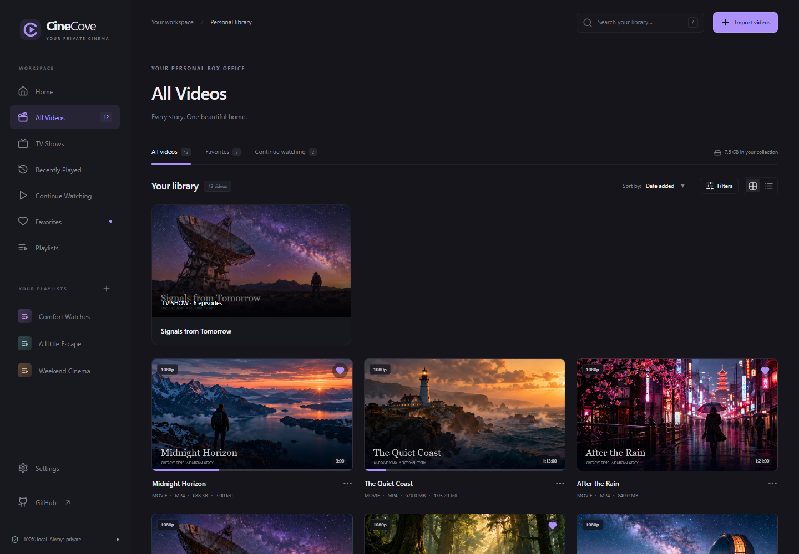

<details>
<summary>Home, player, shows, favorites, playlists, and settings</summary>

**Home**

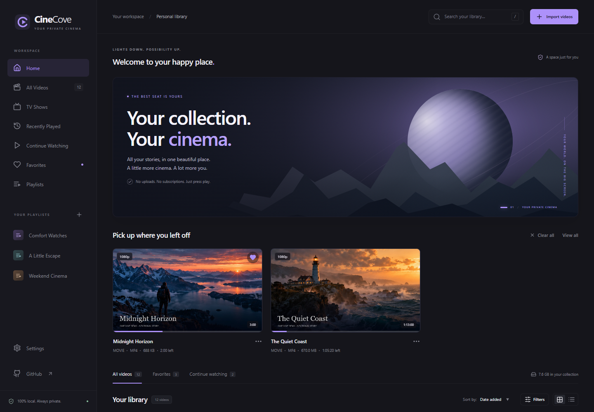

**Local video playback**

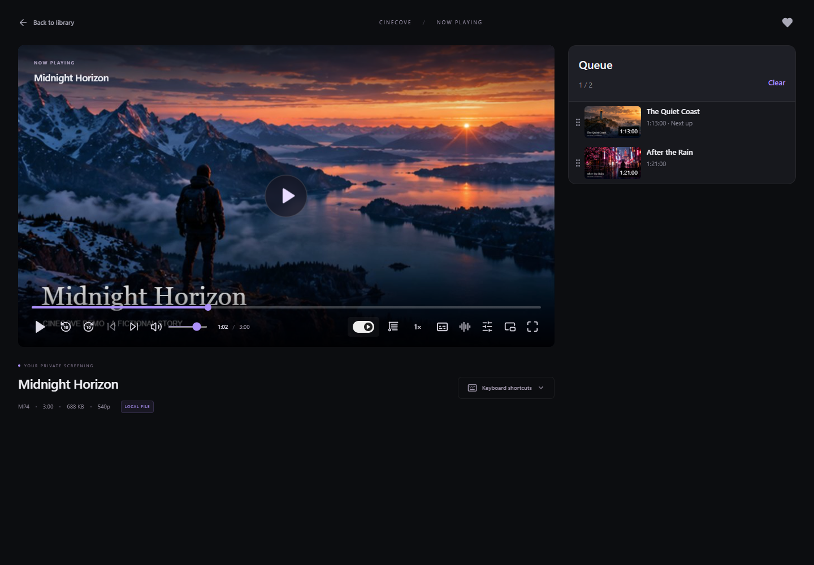

**Queue sidebar**

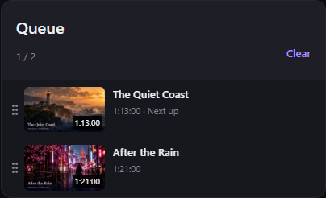

**Blinds mode**

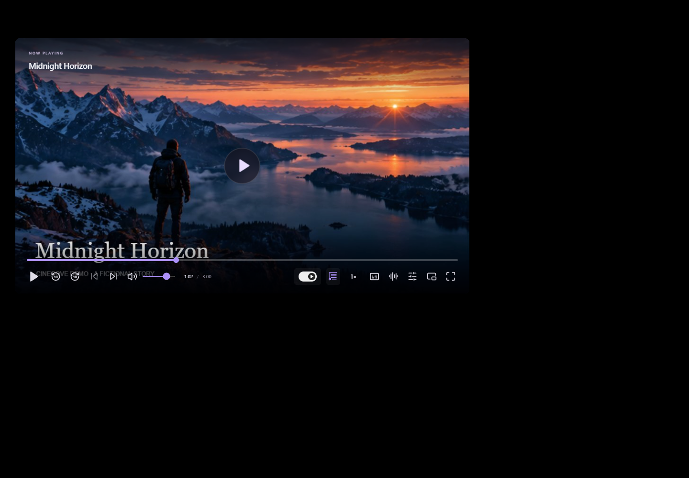

**Floating mini-player**

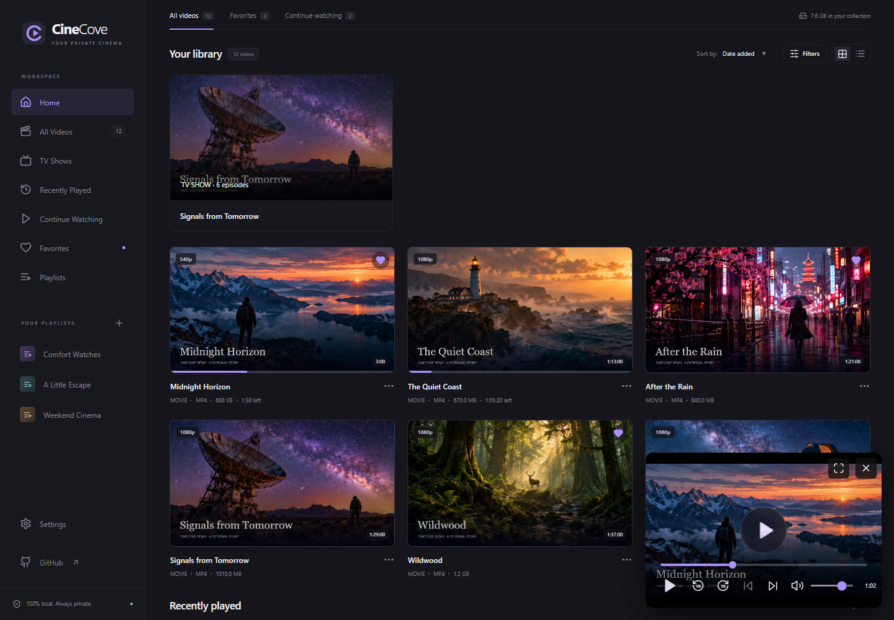

**Custom keyboard shortcuts**

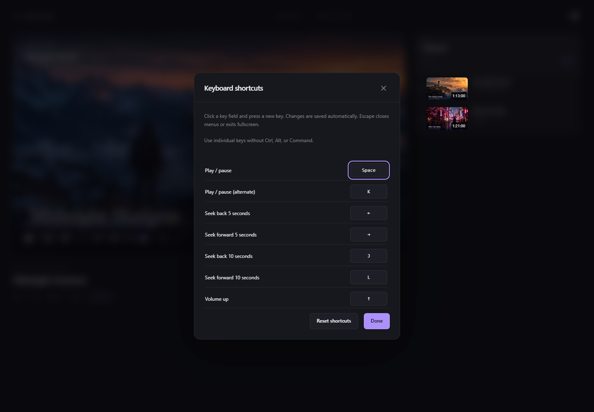

**Bulk playlist selection**

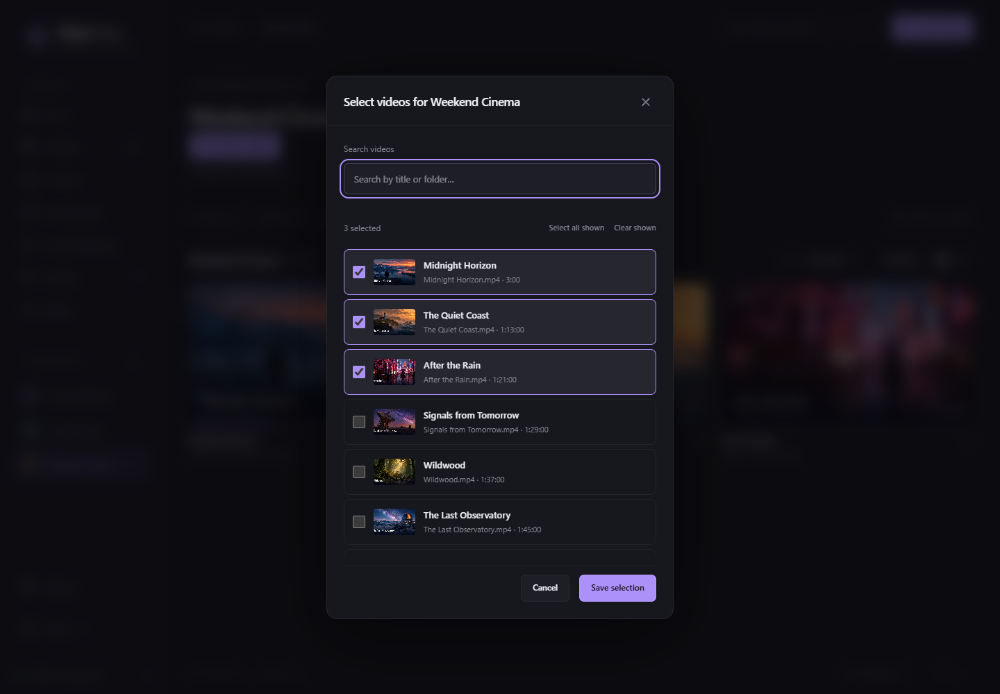

**TV seasons and episodes**

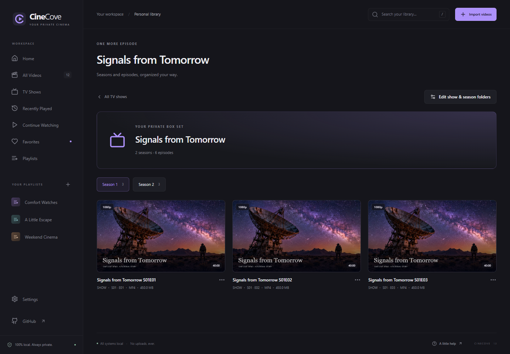

**Favorites**

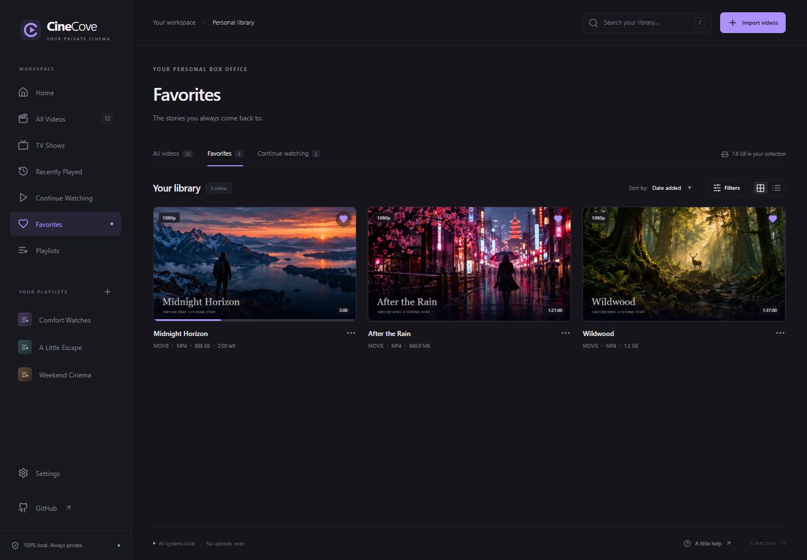

**Playlist collections**

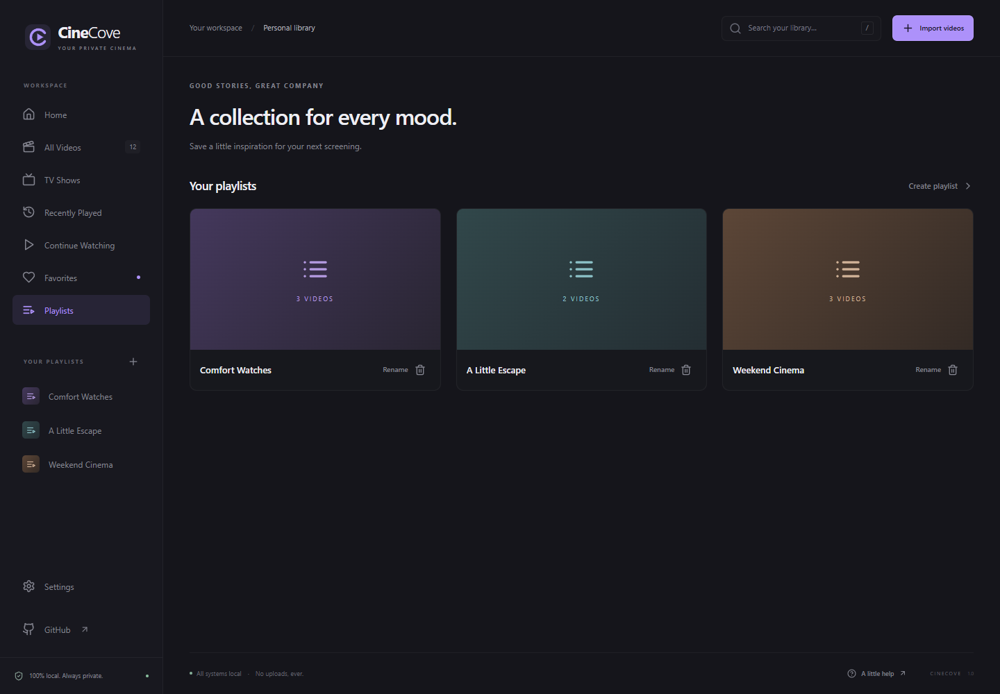

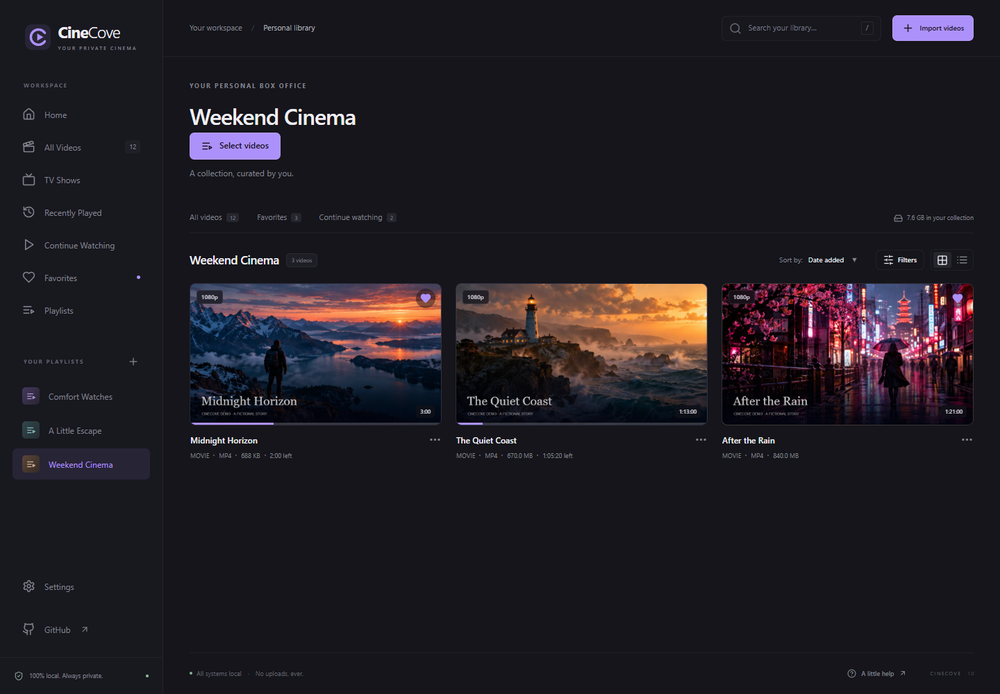

**Daylight theme**

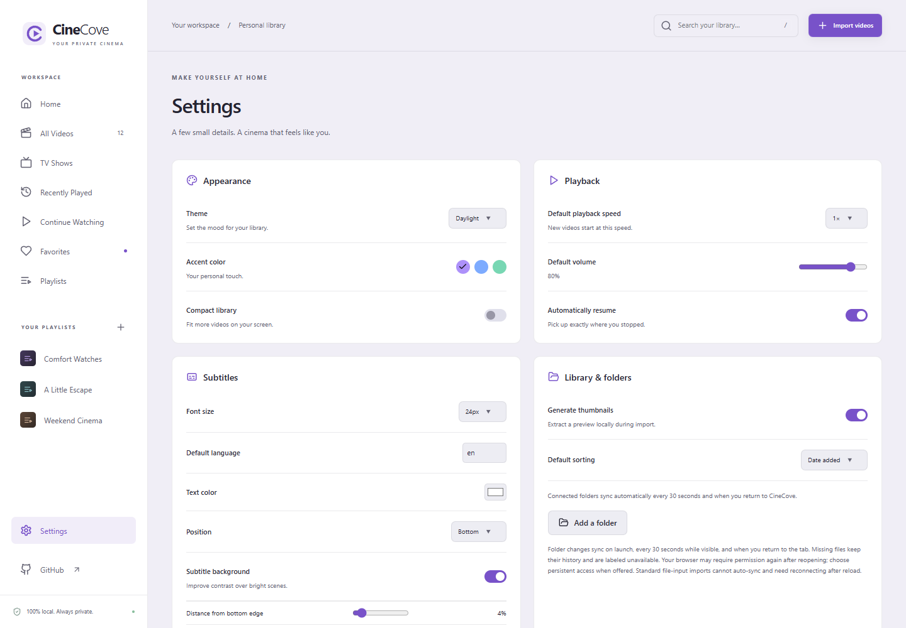

**Subtitle appearance and user data**

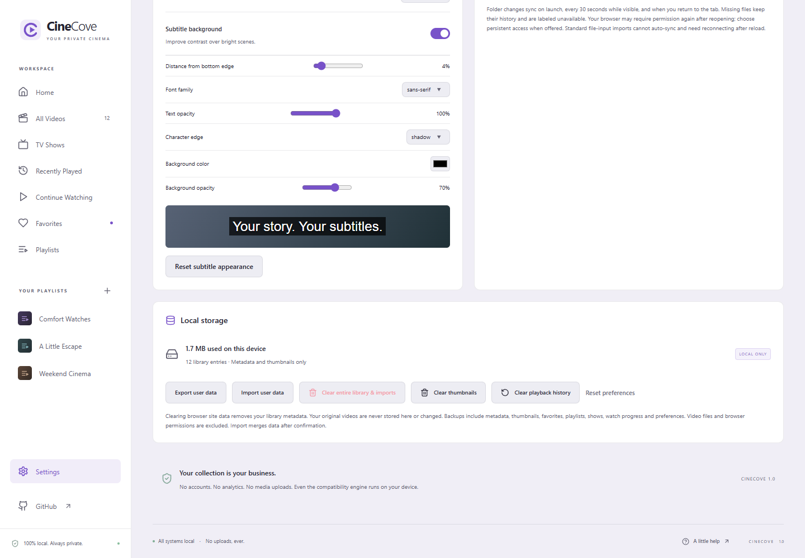

</details>

To reproduce these captures, start `npm run dev`, then run `node scripts/capture-readme.mjs`. Google Chrome must be installed. The script uses a fresh browser context, locally generated sample video, and the artwork atlas in `docs/demo-artwork.png`; it never reads your personal library.

## Features

### Your personal media library

- Import one or more videos, drag and drop files, or connect a folder recursively.
- Browse root folders and subfolders with breadcrumbs and folder-first navigation.
- Search filenames; filter by watch status, movies/TV shows, format, and resolution; sort by name, date, duration, or size.
- Switch between grid and list views, inspect video details, and set custom thumbnails.
- Save favorites and create, rename, edit, or delete playlists. Select videos in bulk with searchable checkboxes.
- Connected folders auto-sync on launch, every 30 seconds while visible, and when returning to the app. Originals are never deleted when you remove library entries; removed entries stay excluded from automatic scans.
- Export and import user data: watch history, favorites, playlists, shows, metadata, thumbnails, and preferences.

### Movies and TV shows

- Create TV shows from the TV Shows page, folder actions, or individual video menus.
- Map folders to seasons, including `Season 1`, `S01`, and special episodes in Season 0.
- Edit season-folder mappings and override assignments for individual episodes.
- Browse episodes by season and move to the previous or next episode across seasons.
- Keep TV organization inside CineCove—no files are moved or renamed on disk.

### Playback that remembers

- Resume from saved positions, with an optional resume-or-restart prompt.
- Save progress, playback speed, completion state, and last-played date.
- Find recently played videos and manage the Continue Watching collection.
- Control seeking, volume, mute, fullscreen, picture-in-picture (where supported), approximate frame stepping, and playback speed from **0.25× to 3×**.
- Use auto-hiding player controls, keyboard shortcuts, and a cached-image seek preview.
- Videos at 85% completion are marked watched, excluded from Continue Watching, and restart on their next opening. Advancing to a later TV episode hides earlier episodes from Continue Watching while keeping their saved positions.
- Enable or disable auto-next in the player. Queued videos follow queue order; without a queue, TV episodes continue across seasons; fullscreen stays active between videos.
- Add videos to the playback queue from their library menus. A thumbnail sidebar appears beside the player only while a queue exists. Drag to reorder, remove items, or clear the queue; no suggestions or search appear in the panel. Queue order and auto-next preferences are saved locally.
- Previous/next controls beside Play follow queue order when a queue exists, or TV episode order otherwise.
- Back to library keeps playback in a floating mini-player. Expand it to return to the player page, or close it to stop playback.
- Use the blinds icon to blacken everything outside the player without entering fullscreen. Click outside the player to restore the page.
- The right-side resume toast dismisses after six seconds; hovering or focusing its controls pauses dismissal.
- Open keyboard shortcuts with **?**, use **A** for audio tracks and **C** to toggle captions, or assign individual keys in the fullscreen-compatible shortcut editor. Duplicate bindings are rejected; **Reset shortcuts** restores defaults.

### Subtitles and audio

- Load external **SRT, WebVTT, ASS, or SSA** subtitles.
- Inspect embedded tracks locally and extract supported text subtitles as WebVTT. Prefer default audio and subtitle tracks and remember whether captions are enabled.
- Adjust subtitle font, size, text color and opacity, edges, background, top/bottom placement, distance from the chosen edge (0–40%), and timing offset (±120 seconds). The default edge distance is 4%; height is controlled by a precise slider in Settings and the player subtitle menu.
- Save subtitle appearance and language preferences locally; restore defaults from Settings or the player.
- Switch native audio tracks where the browser supports them. Browser audio continues while a default embedded audio track prepares, then switches to the ready track.
- For supported streams, decode an alternate stereo AAC track in synchronized 120-second windows, with limited caching and prefetching.

**Subtitle limitations:** Advanced ASS/SSA styling and image-based subtitle formats such as PGS, VobSub, and DVB are not rendered. Embedded extraction may take time and is limited to 10 MB of subtitle output and three cached extracted tracks per open video.

**Audio limitations:** Alternate-track decoding depends on codec, file integrity, memory, and browser support. Independent audio delay and normalization are not available. Audio-output selection appears only where the relevant browser APIs are supported.

### Themes and appearance

- Switch between **Midnight** and **Daylight** interfaces.
- Customize accent colors across the app branding, favicon, navigation, and background details.
- Keep the screening room dark during video playback.

## Getting started

### Requirements

- **Node.js 22.12+** (Node.js 24 recommended)
- npm
- A current version of Chrome, Edge, or Firefox

### Run locally

```bash
npm install
npm run dev
```

Open **http://127.0.0.1:5173**.

Use the same hostname and port to access the same browser library. Browser file-system APIs require a secure context such as localhost or HTTPS; do not open the application using `file://`.

Dependencies are downloaded during installation. Normal media playback and local conversion do not require uploading files to a server.

### Build for production

```bash
npm run build
npm run preview
```

The production build is written to `dist/` and can be served by a static HTTP server. The approximately 32 MB FFmpeg WASM asset is bundled with the app and loaded when needed for embedded-track inspection, extraction, or compatibility conversion. The single-thread engine does not require cross-origin isolation. Preserve the generated directory structure when deploying under a subpath.

## Video formats and compatibility

CineCove recognizes these containers:

`MP4` · `MKV` · `AVI` · `MOV` · `WebM` · `M4V` · `MPEG` · `MPG` · `WMV` · `FLV` · `3GP` · `TS` · `MTS` · `M2TS` · `OGV`

**Recognized does not mean playable.** Actual playback depends on the codecs supported by your browser, operating system, and device. MP4 with H.264/AAC and WebM with VP8/VP9/Opus generally offer broad compatibility. MKV support varies.

CineCove tries native playback first, without copying the full movie into JavaScript memory. If decoding fails, it offers two opt-in recovery options:

| Option               | What it does                                                                               | Trade-off                                                                           |
| -------------------- | ------------------------------------------------------------------------------------------ | ----------------------------------------------------------------------------------- |
| **Repackage as MP4** | Copies the first video stream and converts the first audio stream to AAC.                  | Faster and lossless for compatible video streams, but not every codec works in MP4. |
| **Full conversion**  | Converts the first video/audio streams to H.264/AAC, YUV420p MP4, with maximum width 1920. | Slower and may reduce quality.                                                      |

Compatibility conversion is limited to **256 MB input** and a **10-minute timeout**. These limits do not guarantee success on low-memory devices. Conversion uses additional RAM and temporary WASM storage. The original file is never modified, and temporary output is not saved between sessions.

For large files with unsupported codecs, use desktop FFmpeg, HandBrake, or VLC. Additional original audio and subtitle tracks may remain available through the embedded-track service even when they are not included in the temporary converted MP4.

Resolution filters use measured video dimensions rather than filename claims. For example, 1920×800 is grouped with 1080p, and 3840×1600 with 4K. Exact dimensions appear in video details.

## Local storage and privacy

| Storage            | Contents                                                                                                              |
| ------------------ | --------------------------------------------------------------------------------------------------------------------- |
| **IndexedDB**      | Library metadata, folder and file handles where supported, playlists, history, cached thumbnails, and TV assignments. |
| **LocalStorage**   | Appearance and playback preferences.                                                                                  |
| **Session memory** | File objects from fallback imports and loaded/extracted subtitle cues.                                                |

Chrome and Edge can persist supported file and folder handles, but may ask for read permission again. Browsers without native pickers use standard file or directory inputs, whose files may need to be reselected after a reload. Saved playback positions remain in browser storage.

Folder sync polls connected folders without copying video contents. Scans run on launch, every 30 seconds while the tab is visible, and on focus. New videos are imported and previews are generated only for new entries. Missing or changed originals are labeled unavailable and retain their history; returning files reconnect automatically. A failed scan never marks a partially read folder as missing. Browser permission cannot be bypassed: use Settings → Library & folders → Reconnect when Chrome requests renewed read access, and choose persistent access when offered. Fallback file/directory inputs cannot auto-sync after reload. Files with matching name, size, and modification date are deduplicated. Native folder picking can record empty directories; fallback inputs only infer folders containing selected files.

### Back up or move your library

If an older folder import keeps asking you to locate individual videos after restarting, use **Settings → Library & folders → Reconnect** once to connect it with the native folder picker. CineCove saves the folder handle and restores nested files through that folder. In Chrome, choose **Allow on every visit** when offered. Playback renews saved folder permission directly from the Play click; ordinary file-input imports still require reselection because browsers do not persist their access.

Use **Settings → Local storage → Export user data** to download a versioned JSON backup. **Import user data** validates a backup and asks for confirmation before merging it: matching IDs use backup metadata, other entries stay, and preferences are restored. Existing file handles on this device are retained. Import is atomic for IndexedDB data; videos are never copied. Backups do not include video contents or portable folder permissions, so reconnect folders on another browser or device. Import accepts backups up to 100 MB. Treat the backup as personal data because it contains filenames, folder labels, history, and thumbnails.

**Upgrading from an older CineCove version?** Reconnect and scan previously imported folders once to rebuild subfolder paths. Existing library entries migrate to IndexedDB v2 without clearing the library.

Library data is tied to the browser profile and site origin. Clearing site data can remove library records and preferences, but does not delete original media files.

## Project structure

```text
src/
  App.tsx                 Library coordinator, imports, permissions
  types.ts                Shared types
  components/
    Navigation.tsx        Sidebar, navigation, search
    Library.tsx           Library views, cards, playlists, history
    VideoPlayer.tsx       Player and media controls
    ImportDialog.tsx      File and folder import
    SettingsPage.tsx      Settings and preferences
    FolderBrowser.tsx     Folder navigation and show actions
    TVShows.tsx           Shows, seasons, episode assignments
    UI.tsx                Shared UI primitives and dialogs
  lib/
    media.ts              Native playback, metadata, previews, conversion
    storage.ts            IndexedDB and LocalStorage
    backup.ts             Portable, validated user data backups
    folderSync.ts         Permission-aware local folder scans
    subtitles.ts          Subtitle parsing and safe cues
    embedded.ts           FFprobe, subtitle extraction, audio windows
    useSegmentAudio.ts    Alternate audio synchronization
    organization.ts       Folder and season mapping
  styles.css              Tailwind, themes, layouts
public/
  icon.svg                CineCove app icon
vite.config.ts            Vite and FFmpeg asset configuration
tests/
  app.spec.ts             Browser integration tests
```

Native playback uses object URLs, revoked when switching or closing media. Metadata probing and 480 px JPEG preview generation run sequentially to limit memory pressure, with a seven-second timeout per import probe. Custom thumbnails are resized before caching. Very large libraries may be less responsive because the current filtered view is not virtualized.

## Testing

```bash
npm test
npm run build

# In a separate terminal:
npm run dev

# Then run browser integration tests:
npx playwright test
```

Browser tests use locally installed Google Chrome (`channel: 'chrome'`). Coverage includes import and playback, seeking, speed, subtitles, audio controls, saved progress, favorites, playlists, reconnection prompts, themes, mobile navigation, unsupported-media recovery, and FFmpeg loading. Tests also check that normal playback does not make external network requests.

Additional tests cover subtitle parsing and sanitization, container detection, size/time utilities, conversion limits, nested folders, season assignments, Continue Watching, resolution classification, theme combinations, and IndexedDB migration. MKV tests generate local sample files to exercise remuxing, transcoding, embedded subtitles, and multiple audio tracks.

To run the unsupported-file recovery test against the production preview:

```bash
CINECOVE_TEST_URL=http://127.0.0.1:4173 npx playwright test -g "unsupported file"
```

Manual testing is still recommended for real folder permission prompts, diverse codecs and MKV files, embedded tracks, fullscreen/PiP, and other browser/OS combinations.

## Current limitations

- Browser codec support determines which original files play natively.
- Local FFmpeg conversion is memory-intensive and restricted to smaller files.
- Folder sync runs while CineCove is open; browser permissions must remain granted. It cannot watch folders while the app is closed.
- Browser permissions and file handles may need reconnection.
- Clearing browser site data removes locally stored library information.
- Skip-intro detection is not available because local videos do not provide reliable intro markers.
- Timeline hover decodes nearby frames through a separate, bounded cache; preview decoding depends on native browser codec support.
- Large libraries currently render without grid virtualization.

## Technical references

- [FFmpeg.wasm documentation](https://ffmpegwasm.netlify.app/docs/getting-started/usage/)
- [File System Access API — MDN](https://developer.mozilla.org/en-US/docs/Web/API/Window/showDirectoryPicker)
- [HTMLMediaElement audio tracks — MDN](https://developer.mozilla.org/en-US/docs/Web/API/HTMLMediaElement/audioTracks)

---

**CineCove — your media, your library, your screen.**
